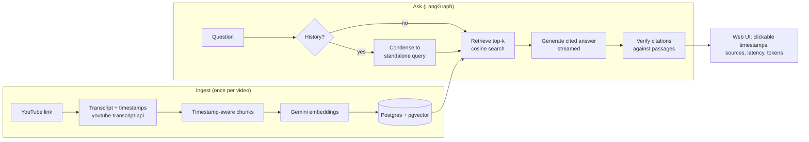

# YtChat

Chat with any YouTube video. Paste a link to get a timestamped summary, then ask questions. Every answer cites the moments it came from, each citation is checked against the passages the model actually saw, and clicking a timestamp jumps the embedded player there.

Built as a RAG system you can measure: everything the model sees and returns (retrieved passages, rewritten queries, citations, latency, token usage, prompt version) is stored per message, ready for the evaluation work in the [roadmap](#roadmap).

## Features

- **Any YouTube link**: watch, youtu.be, Shorts, embed and live URLs. Prefers manual captions over auto-generated ones, in your language order (default English, Hindi, Telugu).
- **Timestamp-aware chunking**: chunks never split a caption line, so every chunk starts at a real caption timestamp.
- **Cited answers with verification**: the model cites `[12:34]`; each citation is checked against the retrieved passages and unsupported ones are flagged in the UI.
- **Multi-turn chat**: follow-ups like "and the second one?" are rewritten into standalone search queries before retrieval (LangGraph conditional edge).
- **Streaming**: summaries and answers stream token by token over server-sent events.
- **Pluggable models**: Gemini by default, Claude with one setting, and an offline embedder for tests.
- **Postgres + pgvector** for chunks, embeddings, conversations and per-message telemetry.

## Architecture



| Step | Module |
|---|---|
| Link parsing, transcripts, metadata | [`ytchat/youtube.py`](ytchat/youtube.py) |
| Chunking | [`ytchat/chunking.py`](ytchat/chunking.py) |
| Embeddings and chat models | [`ytchat/models.py`](ytchat/models.py) |
| Schema and storage | [`ytchat/db.py`](ytchat/db.py), [`ytchat/store.py`](ytchat/store.py) |
| Q&A graph | [`ytchat/graph.py`](ytchat/graph.py) |
| Citation checking | [`ytchat/citations.py`](ytchat/citations.py) |
| Prompts (versioned) | [`ytchat/prompts.py`](ytchat/prompts.py) |
| API and streaming | [`ytchat/api.py`](ytchat/api.py) |
| Web UI | [`ytchat/static/`](ytchat/static) |

## Design decisions

- **Exact search per video, no ANN index yet.** One video has tens to a few hundred chunks, so a full cosine scan is fast and has perfect recall. An HNSW index only pays off when searching across many videos, and filtered HNSW queries can silently return fewer than *k* rows. It comes with multi-video search in Phase 2.
- **The summary skips retrieval.** A one-hour transcript is about 10k words, which fits comfortably in context. The summarizer sees the whole transcript in non-overlapping 60-second windows, so it can't miss sections the way top-*k* retrieval would.
- **Embedding details from Google's docs.** `gemini-embedding-2` merges a list of inputs sent in one request into a single embedding, so each chunk is sent as its own `Content`. It takes the retrieval task as a text prefix (`title: ... | text: ...` for documents, `task: question answering | query: ...` for queries) instead of `task_type`. 768 dimensions keeps the option of an HNSW index (pgvector caps those at 2000).
- **Citations are verified, not trusted.** A citation is valid only if its time falls inside a passage the model was given. This becomes the citation-accuracy metric in Phase 3.
- **Pinned model ids.** `gemini-3.6-flash` rather than a `-latest` alias, so eval results stay comparable over time. It was picked by measurement: in November 2026 testing, `gemini-3.8-flash` (and `gemini-flash-latest`, which points to it) returned "high demand" errors or timed out, `gemini-2.5-flash` was closed to new API keys, and `gemini-3.6-flash` answered in about 5 seconds.
- **Index versioning.** Each video records the embedder and chunking settings it was indexed with. Changing them re-indexes on the next load, which keeps experiments clean.
- **Dependency injection everywhere.** `create_app()` accepts the model, embedder, store and transcript fetcher, so the API tests run the full flow against a real Postgres with a scripted model and no API keys.

## Quickstart

You need Python 3.11 or 3.12 and a Gemini API key from [Google AI Studio](https://aistudio.google.com/apikey).

```bash
python -m venv .venv
```

```bash
# Windows: .venv\Scripts\activate    macOS/Linux: source .venv/bin/activate
pip install -e ".[local,dev]"
```

```bash
ytchat --set-key    # paste your key at the hidden prompt; it's saved to .env
```

```bash
ytchat
```

Open http://127.0.0.1:8000.

The `local` extra installs [pgserver](https://github.com/orm011/pgserver), which runs a bundled Postgres with pgvector in `./.pgdata` without Docker or admin rights. It ships wheels for Python 3.9 to 3.12. To use your own Postgres instead, set `DATABASE_URL`; the database needs the `vector` extension available.

### Docker

```bash
cp .env.example .env    # add GOOGLE_API_KEY
docker compose up --build
```

This starts Postgres 17 with pgvector and the app on http://localhost:8000.

## Configuration

Set these in `.env` or as environment variables.

| Variable | Default | Notes |
|---|---|---|
| `GOOGLE_API_KEY` | (required) | Also accepted as `GEMINI_API_KEY` |
| `LLM_PROVIDER` / `LLM_MODEL` | `google` / `gemini-3.6-flash` | `anthropic` needs the `anthropic` extra and `ANTHROPIC_API_KEY` |
| `LLM_TIMEOUT_S` / `EMBED_TIMEOUT_S` | `60` / `30` | Per-request limits, so a slow or overloaded model shows an error instead of hanging |
| `EMBED_PROVIDER` / `EMBED_MODEL` / `EMBED_DIM` | `google` / `gemini-embedding-2` / `768` | `hash` is an offline embedder for tests |
| `DATABASE_URL` | empty | Empty means the bundled local Postgres |
| `CHUNK_WORDS` / `CHUNK_OVERLAP_WORDS` | `150` / `30` | Chunk size and overlap in words |
| `TOP_K` | `6` | Passages retrieved per question |
| `HISTORY_TURNS` | `6` | Previous Q&A pairs sent with each question |
| `TRANSCRIPT_LANGUAGES` | `en,hi,te` | Caption languages in order of preference |
| `YT_PROXY_URL` | empty | YouTube often blocks transcript requests from cloud IPs; route through a proxy when deployed |

## API

| Method | Path | What it does |
|---|---|---|
| `POST` | `/api/videos` | `{"url": "..."}` fetches, chunks, embeds and stores a video (cached on repeat) |
| `GET` | `/api/videos` | Recently loaded videos |
| `GET` | `/api/videos/{id}` | Video metadata |
| `POST` | `/api/videos/{id}/summary` | Streams the summary (SSE); cached after the first run, `?refresh=true` regenerates |
| `POST` | `/api/chat` | `{"video_id", "message", "conversation_id?"}` streams `meta`, `sources`, `token`... and `done` (answer, verified citations, latency, tokens) |
| `GET` | `/api/conversations/{id}` | Full conversation with citations, sources and telemetry |
| `GET` | `/api/health` | Active model, embedder and prompt version |

Interactive docs at `/docs`.

## Tests

```bash
pytest
```

43 tests: link parsing, chunking invariants, citation checking, and end-to-end API flows (index, summary streaming and caching, cited answers, follow-up rewriting, readable errors for rate limits, bad keys, overloaded models and timeouts) against a real Postgres + pgvector. They need no API keys. Set `TEST_DATABASE_URL` to use your own database instead of a throwaway bundled one.

## Roadmap

- [x] **Phase 1: RAG core.** Transcripts, timestamp chunking, pgvector, LangGraph Q&A with verified citations, streaming UI, multi-turn chat.
- [ ] **Phase 2: Golden dataset.** About 20 videos (including Telugu and Hindi), 100 to 150 human-checked Q&A pairs with gold timestamps, plus unanswerable questions.
- [ ] **Phase 3: Evaluation.** Retrieval recall@k and MRR, faithfulness, citation accuracy, refusal rate, cost and latency, plus a judge-agreement check. Experiments: full transcript vs. RAG, chunk sizes, vector vs. hybrid (the `tsv` column is already indexed) vs. reranking, and model comparisons.
- [ ] **Phase 4: LLMOps.** Langfuse tracing, prompt versioning, an eval gate in GitHub Actions, and a feedback loop from thumbs up/down into the test set.
- [ ] **Phase 5: Ship.** Deployment, demo video, results table in this README.

## Limitations

- Needs captions. Videos without captions fail with a clear message; a Whisper fallback is planned.
- Auto-generated captions contain recognition errors, which can affect retrieval and answers.
- Answers come from what is said, not what is shown on screen (slides and code are not read yet).
